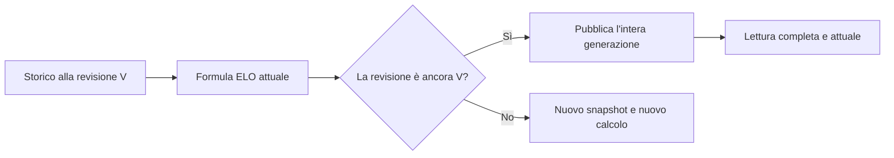

# Aggiornamento ELO coerente — definizione e test sul PC

Checkpoint del 15 ottobre 2026. La formula attuale rimane invariata. Il codice e le tabelle della prova sono soltanto locali; non sono stati modificati Supabase o Vercel, non è stato eseguito alcun deploy e il prototipo non è collegato all'app Android o al sito distribuito.

## Comportamento definito

1. La modifica di partite, punteggi o cataloghi incrementa una revisione nella stessa transazione. Se il salvataggio fallisce, vengono annullati dati e incremento.
2. Il worker legge uno storico completo associato a quella revisione e usa il simulatore ELO già esistente.
3. Il database pubblica insieme rating per gioco, generali e storici soltanto se la revisione è ancora valida. Una revisione superata richiede un nuovo calcolo; un errore lascia intatta la generazione precedente.
4. Il reader riceve un risultato completo e attuale oppure uno stato esplicito di aggiornamento necessario. Ripetere una pubblicazione con lo stesso UUID e contenuto conferma il commit precedente senza duplicarlo e senza riportare indietro la classifica.

## Risultati verificati

| Verifica | Risultato |
| --- | --- |
| Formula e ranking | File `simulation.ts` e `positions.ts` invariati, controllati tramite hash |
| Test dell'adattatore | 36 PASS, inclusi confronto differenziale su 25 storie di 40 partite e input immutabili |
| Suite web completa | 286 test PASS in 13 file |
| PostgreSQL locale 17.4 | 28 casi PASS, comprese le attese reali sui lock in entrambe le direzioni writer/publisher |
| Typecheck, lint mirato e build | PASS |

Le prove coprono rollback, cache superata, due publisher, replay, generazioni vuote, cambio gioco/proprietario, cancellazioni a cascata, metadati e revisioni oltre la precisione intera JavaScript. Uno storico di 1.200 partite produce tutti i 2.400 punti per gioco e i 2.400 punti generali senza troncamento. Non è un benchmark di capacità massima.

Run concluso: `.work/King-Score-atomic/.work/local-elo-publication/b14ee366b35043409efae700484548d3/report.json`. Il cluster è stato arrestato; `remoteContacted=false`. Il caso di risposta persa verifica il replay SQL dopo il commit, senza una caduta HTTP reale. I ruoli sintetici non certificano Auth/RLS Supabase.

## Decisioni prima dell'integrazione reale

L'utente ha successivamente scelto una classifica pubblica unica con tutte le partite di tutti gli account. Il contratto aggiornato richiede `scopeId: "global"`; gli scope proprietario restano diagnostici. La formula rimane identica, applicata all'intero storico globale, senza sommare o mediare classifiche già calcolate per account.

L'ordine dei partecipanti influisce sui punteggi assenti o uguali. Il core conserva esattamente il comportamento attuale, ma le query storiche non garantiscono quell'ordine. La prova usa un ordine persistito sintetico; la sua introduzione reale richiederà una verifica dello storico, senza riordinamento automatico per UUID.

Il contatore globale e il payload unico privilegiano la correttezza; invalidano anche coorti non interessate e non rappresentano ancora un servizio ottimizzato. Rimangono da integrare worker riavviabile, invalidazione dei writer reali, lettori per generazione, ritiro delle scritture ELO legacy, retention e ripristino. Nessuna di queste integrazioni è stata attivata online.

Checkpoint web locale: `162ff30b6178baf2fe3016e7c673943e036fd325`, branch `codex/atomic-play-writers`, senza push. Il [report del checkpoint](evidence/elo-publication-validation.json) è conservato anche in questa repo.

Contratto tecnico, codice e report completo sono nel checkout web locale: `.work/King-Score-atomic/docs/ELO_PUBLICATION.md`, `src/utils/elo/publication.ts` e `docs/evidence/elo-publication-validation.json`. Per ripetere la prova: `./scripts/test-local-elo-publication.ps1` dalla radice del checkout web, con PostgreSQL e dipendenze Node già installati.

Il [contratto di lettura globale](ELO_READ_REVIEW.md) allinea ora decoder, proiezioni e prova database locale. Il prossimo passo è il collegamento dei worker e dell'invalidazione dei writer locali.
